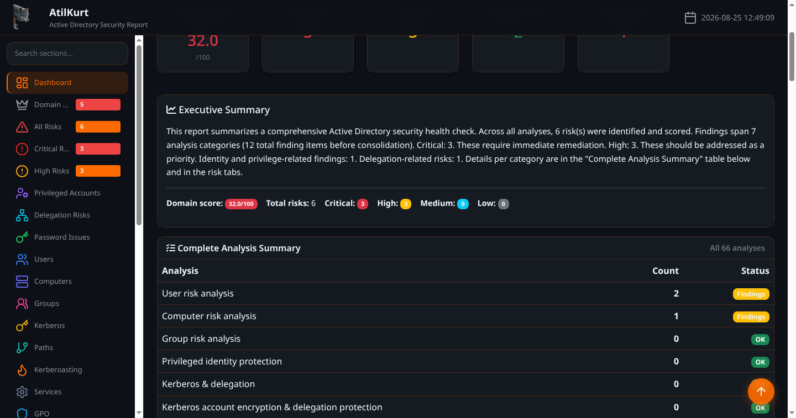
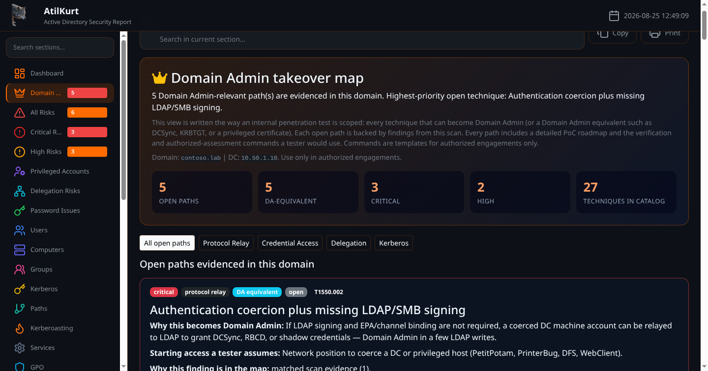
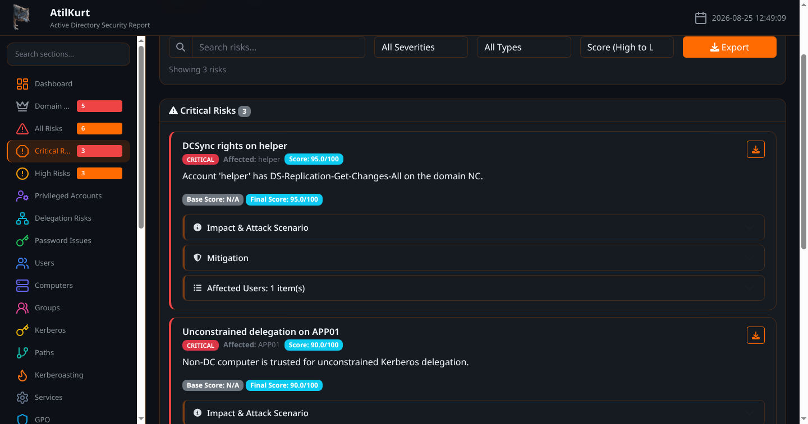
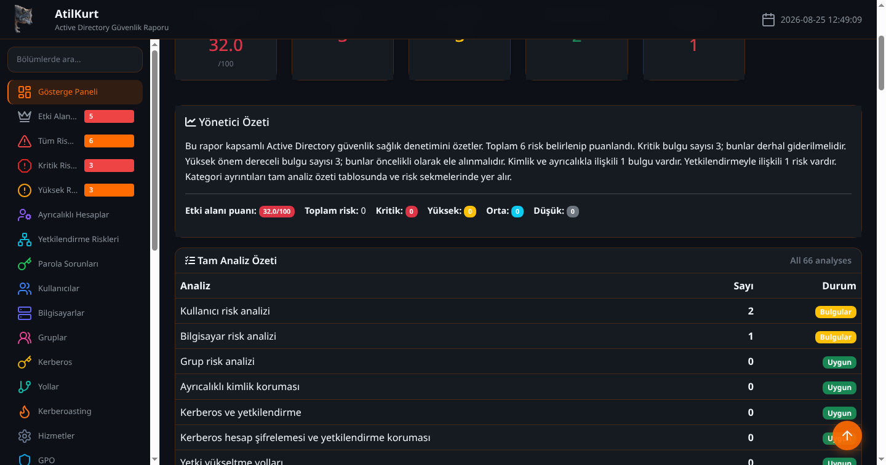
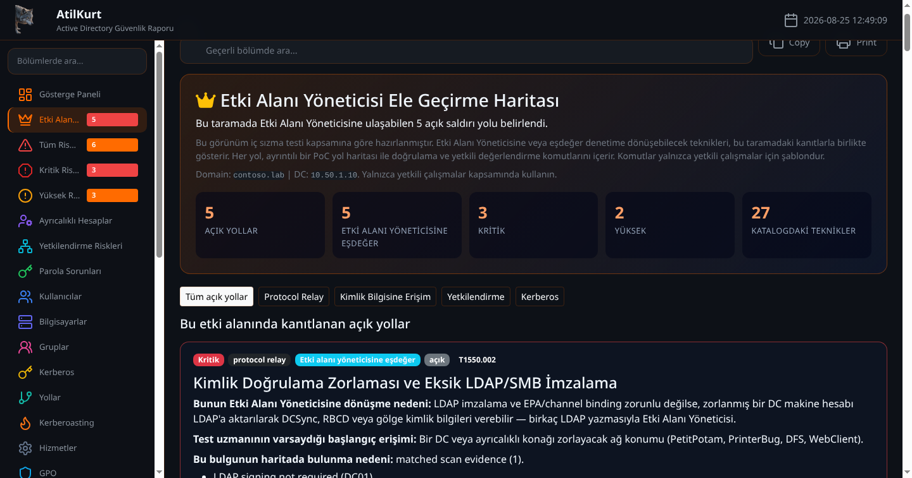
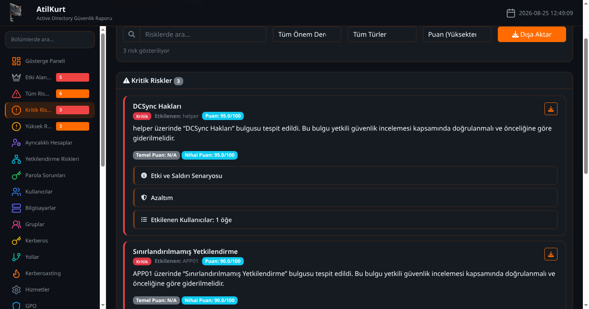

# AtilKurt

[](https://www.gnu.org/licenses/gpl-3.0)
[](https://www.python.org/downloads/)

AtilKurt is a read-only Active Directory security assessment tool. It collects directory data through LDAP, runs a broad set of security analyzers, scores the findings, and generates a self-contained HTML report for offline review. Reports are generated in English by default and can be fully localized to Turkish with `--lan tr`.

## Contents

- [Automatic Installation](#automatic-installation)
- [Simplest Manual Usage](#simplest-manual-usage)
- [Overview](#overview)
- [Screenshots](#screenshots)
- [Key Capabilities](#key-capabilities)
- [How a Scan Works](#how-a-scan-works)
- [Complete Analysis Catalog](#complete-analysis-catalog)
- [Risk Scoring and Prioritization](#risk-scoring-and-prioritization)
- [Finding Validation, Coverage, Exceptions, and Simulation](#finding-validation-coverage-exceptions-and-simulation)
- [Accuracy, Verification, and Operations](#accuracy-verification-and-operations)
- [Compliance Coverage](#compliance-coverage)
- [Requirements](#requirements)
- [Installation](#installation)
- [Configuration](#configuration)
- [Usage](#usage)
- [Domain Admin Takeover Map](#domain-admin-takeover-map)
- [CLI Reference](#cli-reference)
- [Report Output](#report-output)
- [Checkpoints, Incremental State, and Caching](#checkpoints-incremental-state-and-caching)
- [Performance and Scalability](#performance-and-scalability)
- [Docker Usage](#docker-usage)
- [Make Targets](#make-targets)
- [Security Notes](#security-notes)
- [Scope and Limitations](#scope-and-limitations)
- [Testing](#testing)
- [Project Structure](#project-structure)
- [License](#license)
- [Author](#author)

## Automatic Installation

From the application checkout, run:

```bash
./install.sh
Atilkurt --help
```

The installer detects Linux (including WSL), macOS, or a Windows Git Bash/MSYS shell. It reuses a compatible `.venv`, prepares pip if missing, checks the CA certificate store, and installs only missing or incompatible runtime dependencies. Linux uses the available apt, dnf/yum, pacman, zypper, or apk manager. macOS uses Homebrew and installs it from the official installer if Python support is missing. Windows uses an existing Python environment or winget when available, checking the Python launcher and standard installation locations when PATH has not refreshed.

Commands `Atilkurt`, `atilkurt`, and `AtilKurt` use the prepared environment without requiring activation. Commands are installed in `~/.local/bin` for a normal user or `/usr/local/bin` for root. If necessary, the installer adds a PATH entry to the user's shell configuration; open a new terminal to use it. Successful package-manager output stays quiet; a failed step shows its relevant error. Installation ends by printing `Atilkurt --help`.

Compatible dependencies and identical command wrappers are left in place on subsequent runs. Existing `.env` files are preserved and the installer does not write credentials. An unrelated existing command or an unusable environment is reported instead of overwritten. Override paths with `ATILKURT_VENV_DIR` and `ATILKURT_BIN_DIR`, or select Python with `ATILKURT_PYTHON`. System package installation may require sudo; normal scans do not.

## Simplest Manual Usage

After completing either installation method below, a scan needs only the domain, username, and password. If `--dc-ip` is omitted, AtilKurt connects using the domain name:

```bash
ATILKURT_PASS='your-password' \
.venv/bin/atilkurt --domain example.com --username auditor
```

Replace the example values with the assessment account details. The password is passed through the environment instead of a command-line argument, so it is not exposed in the process argument list. If the domain name does not resolve to a reachable domain controller, add `--dc-ip 192.168.1.10`. LDAP on port 389 without TLS is the scan default, equivalent to `--insecure-ldap`. Select `--ssl` for certificate-verified LDAPS, using a DC hostname matching its certificate and `--ca-certs-file company-ca.pem` for an enterprise CA. See [evidence-based security controls](docs/SECURITY_CONTROLS.md).

To generate the same assessment with a Turkish report, add `--lan tr`:

```bash
ATILKURT_PASS='your-password' \
.venv/bin/atilkurt --domain example.com --username auditor --lan tr
```

## Overview

The tool is designed for security assessments, internal red-team style reviews, and directory hygiene analysis. It does not modify Active Directory and is built around LDAP search operations only.

Core goals:

- Collect identity, group, computer, GPO, and ACL data from Active Directory
- Detect misconfigurations, weak controls, and known attack paths
- Map every evidenced Domain Admin / Tier-0 path: the bind account, named non-admin footholds, and the pentest technique catalog
- Correlate optional offline Windows events and exported DC/GPO posture evidence with LDAP findings
- Consolidate findings into a severity-based risk model
- Produce offline-capable English or Turkish HTML reports, JSON/OpenGraph exports, and optional checkpoints
- Support large environments with paging, caching, parallel collection, and incremental execution

## Screenshots

The following images are taken from a **synthetic demo dataset** (`contoso.lab`), not a live domain. They show the self-contained HTML report in English and Turkish. Regenerate them with:

```bash
python3 scripts/generate_demo_screenshots.py
```

### English report

**Dashboard** — domain score, severity KPIs, and executive summary:



**Domain Admin Map** — assessment-account routes, non-admin footholds with evidence, and catalog techniques:



**Critical Risks** — scored critical findings with impact and mitigation accordions:



### Turkish report (`--lan tr`)

**Gösterge Paneli** — same dashboard chrome localized to Turkish:



**Etki Alanı Yöneticisi Haritası** — same map in Turkish (PoC labels localized; command bodies stay paste-ready in English):



**Kritik Riskler** — localized finding titles and UI:



## Key Capabilities

### Directory Inventory

- User, computer, group, and GPO collection
- Object SID collection for identity and ACL correlation
- Large-domain friendly paging and query caching

### Security Analysis

- User, computer, and group risk analysis
- Kerberos delegation, account-level encryption compatibility, privileged-account delegation protection, privilege escalation, and ACL review
- Kerberoasting, AS-REP roasting, DCSync, GPP, LAPS, trust, and password policy checks
- AD CS analysis, including extended certificate abuse paths
- Authentication Policy/Silo, KeyCredentialLink forensics, strong certificate mapping, Windows LAPS v2, RC4 retirement, and AdminSDHolder drift checks
- gMSA-reader, AD CS control-plane, trust, AD-integrated DNS, and hybrid-identity relationship graphs
- Evidence-based Tier-0 shortest paths, chokepoints, and blast-radius analysis
- Domain Admin takeover map: bind-account reachability, named non-admin footholds with reasons and finding evidence, and a pentest technique catalog
- Extended LDAP checks for common privileged-object and configuration weaknesses
- Domain security, audit policy, stale object, gMSA, KRBTGT, machine quota, and replication metadata analysis

### Scoring and Prioritization

- Severity-based domain score
- Exploitability scoring
- Per-finding confidence scoring with a transparent evidence chain
- Risk prioritization and remediation cost estimation
- Business impact and ROI-style remediation views

### Reporting

- Single-file HTML report with embedded assets
- English reporting by default and complete Turkish report localization with `--lan tr`
- Domain Admin takeover map: bind-account routes, named non-admin footholds with reasons and evidence, object-level options, PoC roadmaps, and the unobserved technique catalog
- CISO dashboard with score and critical/high trends when `--history-db` has a previous fresh scan
- Optional BloodHound OpenGraph-shaped Tier-0 graph export
- JSON export for downstream processing
- Optional real DOCX/PDF client deliverables (`--docx-export`, `--pdf-export`) with optional identity masking
- Compliance reporting for CIS, NIST CSF, ISO 27001, and GDPR
- Executive summary and analysis summary tables
- Offline use without a separate `vendor/` directory

## How a Scan Works

AtilKurt follows a deterministic read-only assessment pipeline:

```text
CLI and environment validation
        ↓
LDAP or LDAPS bind
        ↓
Paged collection of users, computers, groups, and GPOs
        ↓
Resolve the bind account (whoami / tokenGroups)
        ↓
Registered security analysis modules
        ↓
Optional event, DC/GPO posture, SYSVOL, and baseline-snapshot correlation
        ↓
Risk deduplication, exploitability assessment, and scoring
        ↓
Domain Admin takeover map (bind account, non-admin footholds, catalog)
        ↓
Compliance mapping and remediation prioritization
        ↓
Localized HTML report, optional JSON/export files, and optional checkpoint
```

The LDAP layer exposes search operations only. AtilKurt does not create, modify, or delete directory objects. Analysis modules consume normalized directory records and return findings; the scoring layer then applies object context and prevalence before sorting the findings. An unexpected analysis failure is surfaced and prevents the run from being reported as successful. A finished report whose directory collection or analysis step is incomplete exits with code 2. In that case an empty finding list is not scored as 100/100 and is not described as a clean result. Password-like assignments in directory description fields are retained by default; --redact-secrets removes their values before checkpoints and reports are written. An ESC1 template whose enrollment flag was not collected stays a finding that needs validation; it is not marked confirmed. Current privilege follows group membership, including nested membership for user-risk checks. A leftover `adminCount` value alone does not count as current privilege.

## Complete Analysis Catalog

The following tables describe every analysis step registered by the application. The value in the **Analysis key** column is also the value accepted by `--skip-analysis`. The option may be repeated when more than one module should be omitted.

### Identity, Endpoint, and Directory Hygiene

| Analysis key | What it evaluates |
| --- | --- |
| `user_risks` | Password-never-expires and password-not-required flags, disabled Kerberos pre-authentication, SPN-bearing users, protected-account indicators, inactive privileged users, disabled Domain Admin and Enterprise Admin accounts (called out separately), other disabled or locked accounts, old service-account passwords, recently created accounts, and recent group-membership changes. |
| `computer_risks` | End-of-life or legacy operating systems, unconstrained and constrained delegation, inactive computer accounts, and computer accounts that appear never to have been used. |
| `legacy_os` | Normalized operating-system names and versions, with separate end-of-life and legacy classifications so older but still supported versions are not reported as EOL. |
| `group_risks` | Excessive Domain Admin membership, nested privileged groups, and populated operator groups that can provide sensitive administrative capabilities. |
| `identity_protection` | Privileged enabled users with reversible password encryption, missing Protected Users membership, or no smart-card requirement. Missing `memberOf` data is not treated as evidence of absence. |
| `service_accounts` | Privileged service accounts, traditional service accounts that could use managed identities, and service-account password lifetime concerns. |
| `stale_objects` | Inactive users, ancient passwords, possible credential disclosure in descriptions, stale computers, and unresolved or orphaned SID references. |
| `honeypot` | Existing accounts that look like deception candidates and directory conditions where a controlled decoy account may improve detection. These are advisory findings, not proof that an account is malicious. |
| `tier_model` | Classification of users, groups, and computers into administrative tiers to expose high-value identities and cross-tier placement concerns. |

### Authentication, Password, and Credential Protection

| Analysis key | What it evaluates |
| --- | --- |
| `kerberos_delegation` | Unconstrained delegation, constrained delegation, broad service delegation, and delegation combinations that may enable impersonation or privilege escalation. |
| `kerberos_account_security` | Enabled user and computer accounts that explicitly advertise DES or RC4 without AES, plus privileged users that do not have the sensitive-and-cannot-be-delegated protection. An absent or zero `msDS-SupportedEncryptionTypes` value is governed by domain/KDC defaults and is not reported as RC4-only evidence. |
| `kerberoasting` | Accounts with service principal names that can be Kerberoasted and accounts without Kerberos pre-authentication that may be AS-REP roastable. |
| `password_policy` | Domain password length, history, age, complexity, reversible encryption, and account-lockout policy attributes. |
| `fine_grained_password_policy` | Password Settings Objects (PSOs) that weaken the domain default for minimum length, history, complexity, lockout threshold, duration, or observation window, as well as any PSO that enables reversible encryption. The finding includes precedence and target principals for remediation context. |
| `password_spray` | Lockout threshold, duration and observation window, privileged accounts without smart-card requirements, password-age patterns, and an overall spray-readiness score. |
| `laps` | Presence of legacy and Windows LAPS expiry attributes, whether Windows LAPS is deployed, and whether the assessment account can *see* readable `msLAPS-Password` values. Password secrets themselves are not retrieved into the report. |
| `gpp_passwords` | Recoverable Group Policy Preference `cpassword` material when that evidence is present on collected GPO records or an opt-in `--sysvol` / `--sysvol-host` / `--sysvol-dir` inspection. LDAP GPO inventory without `cpassword` is not reported as a GPP password finding. SYSVOL is not read unless one of those flags is supplied. |
| `gmsa` | gMSA configuration, principals allowed to retrieve managed passwords, and traditional service accounts that are candidates for migration to gMSA. |
| `golden_gmsa` | KDS root-key exposure and excessive gMSA password-reader conditions associated with Golden gMSA attack paths. KDS objects are located from RootDSE `configurationNamingContext`, not from `CN=Configuration,<domain DN>`. |
| `krbtgt` | KRBTGT password age and encryption configuration indicators that affect Golden Ticket resilience. |
| `authentication_policy` | Authentication Policy and Authentication Policy Silo inventory, privileged-account assignment, missing enforcement, orphaned references, and sensitive accounts outside enforced silos. |
| `key_credential_forensics` | `msDS-KeyCredentialLink` presence, parsed device/key identifiers when available, privileged-object concentration, duplicate material, and malformed or review-required key-credential records. The analyzer reports metadata and does not export private key material. |
| `windows_laps_v2` | Windows LAPS encrypted-password deployment, password-expiration metadata, missing encryption, stale expiration, and recovery/decryption authorization indicators. Password values are not placed in findings. |
| `certificate_mapping` | Strong certificate-binding readiness from domain-controller and Schannel mapping settings, including weak mapping modes and enforcement/backdating configuration that can preserve certificate impersonation paths. |
| `kerberos_rc4_readiness` | Account and domain readiness for retiring RC4, including explicit RC4/DES flags, AES availability, privileged/service-account exposure, and migration blockers. Zero or absent account encryption flags are treated as inherited KDC policy, not direct proof of RC4-only use. |

### Authorization, ACLs, and Attack Paths

| Analysis key | What it evaluates |
| --- | --- |
| `privilege_escalation` | Relationship-based escalation paths across users, groups, computers, SPNs, and delegation. Privileged groups are matched by exact name or well-known RID, not by substring (so Hyper-V Administrators is not treated as Administrators). |
| `acl_legacy` | Compatibility ACL checks for dangerous rights found on collected users, groups, and computers. |
| `acl_security` | Security-descriptor parsing, dangerous ACEs, inheritance concerns, shadow administrators, and multi-hop ACL privilege-escalation paths. Privileged groups are identified by exact name or RID. |
| `dcsync` | Principals with directory replication rights that may permit DCSync-style credential extraction. |
| `gpo_abuse` | GPO modification rights and GPO placement or linkage that could affect privileged organizational units. |
| `backup_operators` | Membership in Backup Operators and other sensitive operator groups, matched by exact group name (so similarly named custom groups are not flagged). |
| `lateral_movement` | Unrestricted privileged logon opportunities, tier-boundary violations, and broad Remote Desktop exposure inferred from directory relationships. Privileged membership uses exact CN/SAM names, not DN substrings. |
| `machine_quota` | `ms-DS-MachineAccountQuota`, account-creation exposure, and creator-SID concentration that can contribute to machine-account abuse paths. |
| `replication_metadata` | Recent sensitive-object changes and tombstone-lifetime settings relevant to change monitoring and recovery. Forest configuration objects (tombstone lifetime) are resolved from RootDSE. |
| `adminsdholder_drift` | AdminSDHolder/SDProp protection drift, protected-object descriptor divergence, stale `adminCount`, missing protection, and dangerous broad ACEs identified from parsed security descriptors. |
| `gmsa_reader_graph` | Effective gMSA managed-password reader relationships, broad reader principals, privileged readers, and graph edges that expose a managed identity to lower-trust principals. |
| `attack_graph_v2` | Deterministic evidence graph combining memberships, parsed ACL findings, and Package B control-plane relationships. It computes shortest paths to Tier-0, shared chokepoints, and reachable Tier-0 blast radius with bounded graph traversal. The Domain Admin takeover map uses this graph for bind-account routes and named non-admin footholds. |

### Domain, Trust, PKI, and Control-Plane Security

| Analysis key | What it evaluates |
| --- | --- |
| `trusts` | Domain trust direction, transitivity, SID-filtering-related indicators, and conditions that expand cross-domain attack scope. |
| `certificate_services` | Forest configuration naming context from RootDSE (so child domains search the forest PKI container). ESC1-like flags use `msPKI-Certificate-Name-Flag` enrollee-supplies-subject plus client-auth/Any Purpose EKU without manager approval. Missing EKU attributes are not treated as ESC2. Template and CA `nTSecurityDescriptor` values are parsed for Certificate-Enrollment / AutoEnroll / GenericAll / AllExtendedRights. A finding is scored only when a low-privilege trustee (Everyone, Authenticated Users, Domain Users/Computers, or a collected non-admin principal) can enroll and the template is published on a CA. Privileged-only enrollment or an unpublished template is not reported. Unreadable ACLs remain `needs_validation`. |
| `adcs_extended` | Extended AD CS indicators for ESC5, ESC7, ESC9, ESC10/14, ESC11, ESC13, ESC15, and Certifried-related conditions. Several CA-wide items are explicit review prompts and require manual confirmation. Configuration objects are resolved from RootDSE, not from `CN=Configuration,<domain DN>`. |
| `vulnerability_scan` | Directory-data heuristics for ZeroLogon, PrintNightmare, PetitPotam, Shadow Credentials, and NoPac. Domain Controllers are identified by `SERVER_TRUST_ACCOUNT`, primary group RID 516, or the Domain Controllers OU — not by the letters `DC` in a hostname. Shadow Credentials findings require `msDS-KeyCredentialLink` on a privileged account. The module does not send exploits or verify patch state. |
| `domain_security` | LDAP signing/channel-binding indicators, NTLM minimum-security settings, and SMB-signing policy evidence found in GPO metadata. |
| `ldap_directory_exposure` | Anonymous LDAP (dSHeuristics), Pre-Windows 2000 Compatible Access membership, enabled Guest (including renamed RID-501 accounts), and outdated domain/forest functional levels that keep legacy enumeration paths open. Directory Service objects are resolved from RootDSE `configurationNamingContext`; child-domain DNs are not prefixed with `CN=Configuration`. |
| `hidden_privilege` | Privileged `primaryGroupID` values that hide Domain Admin-equivalent membership, computer accounts in privileged groups, and renamed RID-500 administrators. |
| `hybrid_identity` | Entra Connect / MSOL_ sync accounts, Seamless SSO (`AZUREADSSOACC`), and ADFS identities identified by service principal names. Missing hybrid-join attributes are reported only when those hybrid components are present, so a purely on-premises forest is not flagged. |
| `rodc_attack_surface` | RODC RevealOnDemand / NeverReveal configuration, privileged principals allowed to cache secrets, and large revealed-user caches. |
| `delegated_msa` | Windows Server 2025 delegated MSA (dMSA) objects and predecessor links used in the BadSuccessor privilege-inheritance attack. Schema presence is resolved from RootDSE `schemaNamingContext` so child domains are evaluated against the forest schema. |
| `sccm_attack_surface` | Configuration Manager `System Management` publication and management-point objects that commonly lead to client-push takeover paths. |
| `extended_ldap` | RBCD, `msDS-KeyCredentialLink`, SID history, foreign security principals, fine-grained password policies, BitLocker recovery objects, AdminSDHolder, OU/GPO structure, empty or deeply nested groups, expired computers, printer and Exchange objects, DNS zones, and AD Recycle Bin state. |
| `audit_policy` | Audit-related GPO discovery, AdminSDHolder and domain-root SACL review guidance, and the critical Windows event IDs recommended for monitoring. |
| `coercion` | Print Spooler, DFS, and WebClient-related directory indicators that may expose authentication-coercion paths. No coercion request is sent. |
| `misconfiguration` | Cross-cutting checklist for password policy, administrative hygiene, delegation, ACL, trust, and tiering weaknesses based on the collected inventory. |
| `adcs_control_plane` | ACL-based ownership and write-control paths across certification authorities, certificate templates, NTAuth, enrollment services, and PKI containers. It records exact trustee/target evidence in a component graph. |
| `trust_security_v2` | Direction, transitivity, SID-filtering/quarantine, selective authentication, forest-wide scope, and trust-account encryption conditions, with cross-domain graph relationships. |
| `ad_dns_security` | AD-integrated DNS zones and nodes, insecure or nonsecure dynamic-update settings, stale/tombstoned data, and dangerous ACL control over DNS records or zone containers. |
| `hybrid_identity_v2` | Entra Connect, Seamless SSO, and AD FS control-plane identities, privileged placement, credential age, delegation/SPN exposure, and relationship edges into sensitive on-premises assets. |

### Modern Analysis Packages

The modern modules are deliberately layered so each later package can reuse evidence produced earlier:

| Package | Focus | Output |
| --- | --- | --- |
| A — Identity hardening | Authentication Policies/Silos, KeyCredentialLink forensics, Windows LAPS v2, strong certificate mapping, RC4 retirement, and AdminSDHolder drift | Stable risk identifiers and LDAP/security-descriptor evidence suitable for English or Turkish reporting |
| B — Control-plane graphing | gMSA readers, AD CS ACLs, trusts, AD DNS, hybrid identity, and a combined Tier-0 attack graph | Component graphs, shortest Tier-0 paths, chokepoints, blast radius, and an OpenGraph-shaped representation |
| C — Evidence and change | Offline Windows events, exported endpoint/GPO posture, full snapshot deltas, and confidence scoring | Correlated telemetry findings, verified posture gaps, risk/object/edge drift, and a transparent evidence chain for every consolidated finding |

Package C is optional-input aware. A normal LDAP scan still runs without extra files and every finding receives a confidence assessment. `--event-log`, `--posture-file`, and `--baseline` add direct evidence or change context before risk scoring. These inputs can also enrich a full `--resume` checkpoint without repeating LDAP collection.

### Full and Fast Profiles

`--analysis-profile full` runs every registered analysis and is the default. `--analysis-profile fast` keeps the broad inventory and common risk checks but skips these query-heavy modules:

- `acl_legacy`
- `acl_security`
- `extended_ldap`
- `adcs_extended`
- `coercion`
- `replication_metadata`
- `adminsdholder_drift`
- `adcs_control_plane`
- `ad_dns_security`
- `attack_graph_v2`

Use `--skip-analysis KEY` for explicit control. Skipped modules produce empty result sections instead of breaking report generation, which keeps the JSON and HTML schemas predictable.

## Risk Scoring and Prioritization

Each consolidated finding receives:

- A base score derived from its risk type, or a severity-based fallback for new risk types
- An object-context multiplier for privileged users, domain controllers, groups, computers, and GPOs
- A prevalence multiplier when the same weakness affects multiple objects
- Combination bonuses when multiple related weaknesses affect the same object
- A final score from 0 to 100 and a normalized Critical, High, Medium, or Low severity
- A separate exploitability model with attack complexity, vector, required privileges, user interaction, known tooling, and a 0-to-10 exploitability score

The domain security score summarizes the scored findings. The risk-management section builds an impact-versus-likelihood heat map, estimates remediation effort, applies the configurable `--hourly-rate`, and calculates prioritization and ROI-style values. These business values are planning estimates, not financial guarantees.

### Evidence requirements and false-positive reduction

Findings that still need host, CA, policy, or ownership verification carry `finding_status: needs_validation` and `score_excluded: true`. They remain visible in HTML and JSON with their original `potential_severity`, a Low presentation severity, and a zero `final_score`. They do not increase prevalence/combination bonuses, the domain-risk penalty, remediation-cost priorities, risk-based compliance failures, or open Domain Admin path counts. The takeover map lists them under **Paths requiring validation**. An assessment with only unverified findings is not proof of a secure environment; the domain score describes the findings supported by the collected evidence.

This applies to OS-only CVE estimates, coercion/service-presence heuristics, template flags without enrollment/publication evidence, legitimate component-presence checks, KeyCredential ownership reviews, and LAPS absence observations. ESC1/ESC2 (and template ESC9/ESC15) findings with a parsed low-privilege Enroll grant and CA publication are scored; they are not left in `needs_validation` solely because they are certificate findings. LDAP cannot establish patch status, a running service, effective endpoint policy, or the absence of a confidential attribute. Confidence scores are rule-based evidence ratings, not statistically calibrated probabilities of compromise.

ACL analysis distinguishes scoped extended/property rights from unrestricted grants, preserves deny ACEs and DACL order, ignores inherit-only ACEs on the current object, and rejects truncated descriptors. DCSync requires both Get-Changes and Get-Changes-All rights on the domain root, including collected nested-group membership; one replication right is insufficient. Expected administrative grants are excluded from escalation findings. Missing or malformed password/lockout/posture values remain unknown rather than becoming zero/disabled settings.

Windows access checks can additionally depend on uncollected token groups, conditional ACEs, property sets, and endpoint state. Use the retained validation findings and fresh endpoint evidence to resolve those limits. A full new scan is required to apply corrected collection/analyzer behavior to an old checkpoint; resuming a completed checkpoint without new evidence reuses its saved results.

The interpretation follows Microsoft's [access-check rules](https://learn.microsoft.com/en-us/windows/win32/secauthz/how-dacls-control-access-to-an-object), [trust-direction specification](https://learn.microsoft.com/en-us/openspecs/windows_protocols/ms-adts/5026a939-44ba-47b2-99cf-386a9e674b04), and [Kerberos event 4769 documentation](https://learn.microsoft.com/en-us/previous-versions/windows/it-pro/windows-10/security/threat-protection/auditing/event-4769). Regression fixtures exercise benign, incomplete, denied, and genuinely dangerous configurations; they do not measure a production false-positive rate.

## Finding Validation, Coverage, Exceptions, and Simulation

The offline HTML report includes four workspaces in English and Turkish:

- **Finding Validation** lists prerequisites, applied decisions, and endpoint observations. Review a finding, document the source and collection time, and export `atilkurt-review.json`. Decisions in the browser are drafts until imported into a new report. Download the local PowerShell collector here or generate it with `--validation-script Collect-AtilKurtEvidence.ps1`.
- **Scan Coverage** separates completed, skipped, and unrecorded analyzers from controls with imported policy evidence. An empty analyzer result is not evidence that a skipped check passed. The dashboard shows execution coverage next to its score explanation.
- **Risk Exceptions** records an exact finding, owner, reason, and UTC expiry. Exceptions are bound to the observed configuration and rule version. Expired or changed records stop excluding risk from scores and remediation priorities. Accepted risks remain visible in takeover paths and risk-based compliance evidence.
- **Remediation Simulation** removes selected control relationships in memory and recomputes Tier-0 reachability, including alternative routes and parallel permission grants. It reports exposed sources and reachable source/target pairs before and after the proposed removals. Export a scenario for repeatable CLI evaluation with `--remediation-scenario`.

The local collector reads registry policy, service state, OS/update metadata and computer RSoP. It writes evidence and a companion XML report; it does not change directory objects, services, or policies. Its hotfix inventory is partial and cannot independently confirm patch coverage. CA publication/enrollment, key ownership, and other missing prerequisites still need the indicated independent review. Resultant policy export follows Microsoft's [gpresult documentation](https://learn.microsoft.com/en-us/windows-server/administration/windows-commands/gpresult).

Example first scan:

```bash
ATILKURT_PASS='your-password' Atilkurt -d example.com -u auditor --ssl \
  --json-export scan.json --validation-script Collect-AtilKurtEvidence.ps1 --lan tr
```

Run the downloaded collector locally on the relevant Windows host, then import the observations. In the report, complete the prerequisite checks and export your review file:

```powershell
.\Collect-AtilKurtEvidence.ps1 -OutputPath .\dc01-evidence.json
```

Rebuild from the saved JSON export without credentials or an LDAP connection:

```bash
Atilkurt -d example.com --offline-snapshot scan.json \
  --validation-evidence dc01-evidence.json --review-file atilkurt-review.json \
  --remediation-scenario atilkurt-scenario.json \
  --output reviewed.html --json-export reviewed.json --lan tr
```

Review documents use `schema_version: 1`, `domain`, `reviews`, `exceptions`, and `observations`. A decision must include the finding ID, evidence fingerprint, rule version, reviewer, reason, review/expiry timestamps, and prerequisite checks. Each check has a name, `pass`/`fail`/`unknown` result, target, source, and collection timestamp. Confirmation requires all prerequisites to pass; a false-positive decision requires at least one failed prerequisite. Reviewer decisions are explicit assessment attestations, not independently signed machine proofs. Review evidence defaults to a maximum age of 30 days (`--evidence-max-age-days`, up to 365). Unknown, stale, conflicting, cross-domain, or changed evidence cannot silently promote a candidate finding.

Decisions persist in JSON exports and checkpoints; offline rebuilding and checkpoint resumption re-evaluate expiry. Offline reports reuse directory evidence and regenerate risk-based compliance; they do not constitute a fresh LDAP scan or fresh endpoint validation. Old exports without domain metadata are unsuitable for offline rebuilding. Simulation is limited to the collected graph and six hops, and does not model operational dependencies or predict a production risk score. It never executes a remediation. Search filters the relationship list while preserving selections; at most 300 matching rows are displayed at once. Graphs that exceed simulation size or traversal limits still produce an assessment, with simulation exposure explicitly marked unknown.

## Accuracy, Verification, and Operations

Two additional offline report workspaces, **Accuracy & Evidence** and **Remediation Operations**, show rule measurements, collection health, token evidence, signatures, shared causes, retest results, scan history, notifications, and work assignments. Both workspaces support English and Turkish. Browser assignments remain drafts until exported and imported through the CLI.

### Diagnostics and Rule Measurements

```bash
Atilkurt doctor
Atilkurt doctor -d example.com -u auditor --dc-ip dc01.example.com --output doctor.json
Atilkurt quality --output quality.json
```

`doctor` checks Python, runtime packages, and the certificate trust store locally. A domain enables bounded DNS/TCP/TLS checks; a username additionally enables authenticated read-only RootDSE, schema, and domain-root attribute checks. Use a protected `ATILKURT_PASS` environment value for authentication. LDAPS is the diagnostic default; `--no-ssl` selects LDAP. A missing schema or attribute observation is reported as unknown rather than denied or absent.

Every normal LDAP search records its scope, base, hashed query ID, completion, returned-object count, elapsed time, and missing-value counts. The ledger excludes attribute values, filters, and credentials, and is bounded to 10,000 queries. A completed ledger means recorded searches completed, not that the account can see every directory object. Read errors and ledger overflow prevent absence-based remediation closure. HTML shows the first 100 queries; JSON retains the bounded ledger.

The bundled quality dataset runs 49 labelled scenarios against nine rule families: replication rights, password policy, legacy-DC vulnerability candidates, broad ACL grants, AD CS ACL control, delegation flags, GPO applicability, trust protections, and LAPS. It reports precision, recall, false positives, missed positives, and unknown results; an unknown prediction for an expected positive counts as a missed positive. These measurements describe the supplied fixtures and cannot establish a production false-positive rate. Families without labelled cases are not measured.

Supply additional labelled cases with `Atilkurt quality --dataset labelled-cases.json`, or attach them to a report with `--quality-dataset labelled-cases.json --quality-export quality.json`. Example:

```json
{
  "schema_version": 1,
  "cases": [
    {
      "id": "short-domain-password",
      "rule": "registry",
      "expected": "positive",
      "risk_types": ["password_policy_weak"],
      "input": {
        "steps": ["password_policy"],
        "ldap_rows": [{"minPwdLength": 6}],
        "data": {"users": [], "groups": [], "computers": [], "gpos": []}
      }
    }
  ]
}
```

Cases require unique IDs and an expected `positive`, `negative`, or `unknown` result. The `registry` adapter accepts registered analysis step keys, optional `risk_types`, fixture directory collections, default `ldap_rows`, and exact query overrides of `{ "base": "DN", "filter": "LDAP filter", "rows": [] }`; `error: true` models an unavailable query. No fixture connects to LDAP. Built-in adapters `dcsync`, `password_policy`, `zerologon`, and `broad_acl` use the shapes in `analysis/rule_quality.py`. Evaluation is bounded to 1,000 cases and 10,000 queries per case. The output records the rule version and dataset fingerprint.

### Effective Access and Shared Causes

```bash
Atilkurt -d example.com -u auditor --ssl --verify-effective-access \
  --token-limit 50 --token-delay 0.1 --json-export scan.json
```

The optional token phase reads `tokenGroups`, `objectSid`, and `sIDHistory` with BASE scope for accounts associated with critical or ACL findings. It checks that the response belongs to the requested SID, enforces a 1–500-account limit and delay, and recalculates completed ACL, DCSync, and attack-graph analyses. Failed or unreadable tokens remain unknown and cannot reuse a previously collected token as fresh proof. Conditional ACEs, claims, service authorization, and endpoint behavior still need independent validation.

Shared-cause groups link explicit permission grants to the collected findings and paths that use them. Related paths can appear in several groups when they depend on several grants. Grouping preserves individual findings, scores, and alternative paths. Use the existing remediation simulation to evaluate proposed grant removals; grouping never changes Active Directory.

### History, Retesting, and Work Assignments

Keep an initial snapshot and local history, then compare selected findings against a fresh assessment:

```bash
Atilkurt -d example.com -u auditor --ssl \
  --history-db assessment.sqlite3 --json-export before.json --tickets-export tasks.json
Atilkurt -d example.com -u auditor --ssl \
  --history-db assessment.sqlite3 --retest before.json \
  --retest-export retest.json --notifications-export changes.json --json-export after.json
```

Repeat `--retest-finding FINDING_ID` to select exact findings; omit it to retest all snapshot findings. Results are `resolved`, `still_present`, or `insufficient_evidence`. Absence can close an LDAP-backed finding only after fresh collection within 24 hours, all registered analysis steps completing, successful recorded queries, matching domain/rule version, and relevant attribute visibility. Pending candidates and conditions originally requiring runtime or ownership validation need independent retesting even if LDAP no longer reports them. Fast profiles, skipped checks, offline rebuilds, stale data, and failed reads cannot establish closure. A baseline drift comparison is separate from verified remediation closure.

Protocol and SYSVOL findings require independent retesting. A fresh directory scan alone cannot close a prior SMB/signing/EPA or shared-file exposure finding when the corresponding check was not repeated.

The SQLite history isolates domains and distinguishes fresh scans from rebuilt reports; only fresh scans are plotted. Missing findings without verified closure become `unassessed`. New supported critical findings, reopened supported findings, and expired exceptions create deduplicated local notification records. Repeating an unchanged assessment does not repeat them. History, notification, ticket, or audit options enable history storage; the latter options default to `.atilkurt_history.sqlite3` when no database is specified. When `--history-db` is used, the CISO dashboard compares the current domain score and critical/high counts with the previous fresh scan and labels the trend `improving`, `worsening`, `stable`, or `no prior scan`.

Scan changes, task imports, audit entries and alert deduplication are committed together after all requested reports and exports succeed. A publication or import failure rolls back the database changes, so a retry can still deliver the original notifications. Each output file is replaced atomically, but the complete set of files is not a single filesystem transaction: a failed run may leave some new artifacts and must not be treated as a completed assessment.

Work items use stable `AK-<finding_id>` external IDs, owners, UTC due dates, notes, and `open`, `in_progress`, `awaiting_verification`, or `resolved` status. Prepare assignments in the report and export `atilkurt-tasks.json`, then import it with `--history-db assessment.sqlite3 --ticket-file atilkurt-tasks.json --tickets-export tasks.json`. Importing the same assignments is idempotent. Task closure requires verified remediation; reappearing supported or pending findings reopen their tasks. Work files provide a local integration contract for an issue system; AtilKurt does not create remote tickets or send messages.

Recurring scans use protected environment credentials and fresh collection:

```bash
Atilkurt watch --interval 3600 --runs 24 --scan-timeout 1800 \
  --history-db assessment.sqlite3 -d example.com -u auditor --ssl --output report.html
```

`watch` requires `ATILKURT_PASS` from a protected environment. It disallows command-line passwords, checkpoint resumption, and offline snapshots. `--runs 0` continues until Ctrl+C; the interval minimum is 60 seconds. Scan output is suppressed during successful cycles; failures and important changes are printed. Notifications are written beside the database as a local JSON outbox. No network notification delivery is configured.

### Signed Evidence, Audit, and Integration Exports

```bash
Atilkurt keygen --private-key assessment.private.pem --public-key assessment.public.pem
Atilkurt sign --input atilkurt-review.json --output review.signed.json \
  --signing-key assessment.private.pem
Atilkurt verify --input review.signed.json --trusted-key assessment.public.pem
Atilkurt -d example.com --offline-snapshot before.json \
  --review-file review.signed.json --trusted-key assessment.public.pem --output reviewed.html
Atilkurt audit --history-db assessment.sqlite3 --output audit.signed.json \
  --signing-key assessment.private.pem
```

Signing uses JWS flattened envelopes with fixed PS256/RSA-PSS/SHA-256. Key generation creates a new 3072-bit key pair without overwriting existing files. Signature verification always requires explicitly supplied trusted keys; embedded keys are not trusted. `--trusted-key` is repeatable. Add `--require-signed-evidence` to reject unsigned review, collector, offline snapshot, retest, baseline, and ticket JSON inputs. Sign a collector JSON file with `sign` after collection. Other posture/event exports and graph/scenario/checkpoint files are outside this signature policy. Signing proves integrity and signer identity against the supplied key, not the accuracy or freshness of the observations.

`--signing-key` signs JSON snapshots and review, quality, retest, notification, ticket, and audit workflow exports. `--audit-export` exports the audit during a report run. The database stores a SHA-256 audit chain with scan changes, review/exception attribution, and task updates. Chain verification detects inconsistent entries; an attacker who can rewrite the entire database can recompute an unsigned chain. Retain signed audit exports outside the database as independent checkpoints. Private keys and directory exports require protected storage; signing does not encrypt the data.

```bash
Atilkurt -d example.com -u auditor --ssl --history-db assessment.sqlite3 \
  --csv-export findings.csv --siem-export findings.jsonl --cef-export findings.cef \
  --export-changes-only --audit-export audit.json
```

CSV, SIEM JSONL, and CEF exports preserve stable finding IDs and evidence/review states. `--export-changes-only` requires history and emits changed findings, including explicit `resolved` or `unassessed` records for missing findings. Consumers must use these states rather than infer active risk from severity alone. Outputs are replaced on each run, including empty results; a downstream shipper can consume them without receiving duplicate unchanged findings. The application writes local artifacts and does not connect to a SIEM or issue-system API.

## Compliance Coverage

The report maps applicable findings and LDAP-derived checks to:

- CIS Benchmark controls and CIS Controls v8 references
- NIST Cybersecurity Framework functions and categories
- ISO/IEC 27001 Annex A control families
- GDPR Article 32 security expectations

Compliance output is an assessment aid. It does not by itself establish certification or legal compliance; controls that cannot be verified from LDAP are marked for review or not assessed rather than treated as silently passing.

Offline, findings-only compliance results use `assessment_basis: findings_only` and mark checks without supporting findings as `unknown`. The HTML shows **Not assessed** instead of a compliance percentage; legacy numeric score fields remain `0.0` for compatibility and must be interpreted together with `assessment_basis` and `assessment_status`. Directory-based CIS Controls v8 percentages cover only the three implemented safeguard mappings, with duplicate failures counted once. Missing inventory, failed reads, and restricted collection cannot establish passed controls.

Risk exports preserve `source_severity` so repeated scoring and offline report regeneration do not inflate severity. Snapshot drift reports use `unobserved_risks` for findings absent from the new snapshot; only the `--retest` workflow can verify remediation. Checkpoints and regular JSON exports are both supported as baseline inputs. See [the code quality audit](docs/CODE_QUALITY_AUDIT.md) for fixes and validation details.

## Requirements

- Python 3.9 or later
- LDAP read access to the target domain
- Valid credentials for the target Active Directory environment

Recommended environment:

- A dedicated assessment workstation
- Network reachability to the domain controller
- Read-only credentials with the minimum permissions needed for the checks you want to run

## Installation

### Automatic Linux Setup

Clone the repository:

```bash
git clone https://github.com/cumakurt/AtilKurt.git
cd AtilKurt
```

The recommended launcher performs the following checks on every run and starts the application:

1. Confirms that the host is Linux and reads `/etc/os-release`.
2. Detects APT, DNF/YUM, Pacman, Zypper, or APK.
3. Verifies Python 3.9 or later and the system CA certificate store.
4. Creates or reuses the project virtual environment.
5. Verifies every version constraint in `requirements.txt` and runs `pip check`.
6. Installs only missing or incompatible system/Python dependencies.
7. Reads the supported `.env` keys as plain data, validates required inputs, and launches AtilKurt.

```bash
./run.sh --help
```

The launcher requests `sudo` only if a required system package is missing. Once the runtime and dependencies satisfy the declared requirements, subsequent runs print a skip message instead of reinstalling them. Override the default `.venv` or `.env` locations with `ATILKURT_VENV_DIR` and `ATILKURT_ENV_FILE`.

### Manual Setup

If you prefer to manage the environment yourself, create an isolated virtual environment and install the project with its runtime dependencies:

```bash
python3 -m venv .venv
.venv/bin/python -m pip install --editable .
```

Activate the environment if you want `python` and the installed `atilkurt` command to resolve from it:

```bash
source .venv/bin/activate
```

For development, install the test and lint tools as well:

```bash
.venv/bin/python -m pip install --editable ".[dev]"
```

## Configuration

### Environment Variables

Copy `.env.example` to `.env`, restrict its permissions, and set the assessment values:

```bash
cp .env.example .env
chmod 600 .env
```

`run.sh` reads only the supported keys as data; it does not execute or source `.env`. Existing process environment variables take precedence over values in the file.

Supported environment variables:

- `ATILKURT_DOMAIN`: Target Active Directory DNS domain; equivalent to `--domain`
- `ATILKURT_USER`: Assessment username; equivalent to `--username`
- `ATILKURT_PASS`: Assessment password; consumed directly by the Python process
- `ATILKURT_DC_IP`: Optional domain controller IP address or hostname; equivalent to `--dc-ip`
- `ATILKURT_OUTPUT`: HTML output path; equivalent to `--output`

Launcher-only overrides:

- `ATILKURT_ENV_FILE`: Use a different environment file
- `ATILKURT_VENV_DIR`: Use a different virtual environment directory

Explicit CLI options take precedence over equivalent `.env` values. Existing process environment variables take precedence over `.env`. For passwords, `ATILKURT_PASS` takes precedence over the deprecated `--password` option; when neither is present, an interactive terminal receives a hidden password prompt.

### Authentication and Transport

A username may be supplied as `username`, `DOMAIN\username`, or `username@example.com`; the connection layer normalizes it for LDAP authentication.

- LDAP on port 389 without TLS is the scan default (`--insecure-ldap`). `--ssl` selects certificate-verified LDAPS on port 636; `--starttls` requires TLS before binding on port 389. SIMPLE never runs without TLS.
- Authentication defaults to NTLM without fallback. Select `--auth-method simple` explicitly over TLS, or `--auth-method kerberos` to use an existing ticket cache.
- TLS certificate validation is enabled by default. A failed explicit LDAPS connection is reported and never downgraded to plaintext LDAP.
- `--no-validate-cert` is intended only for controlled labs with a certificate chain that cannot be validated.
- Connection and search failures use bounded retry and timeout settings; failed LDAP result codes are not cached as successful empty results.

### Certificate Validation

TLS certificate validation is enabled by default for LDAPS and StartTLS. An explicit TLS connection never falls back to plaintext LDAP. Disable certificate validation only for controlled lab environments.

### Output Files

By default, the tool writes:

- HTML report
- Optional JSON export
- Optional Kerberoasting export
- Optional Tier-0 attack-graph export
- Optional checkpoint file

Reports, exports, and checkpoints are written atomically with owner-only file permissions. The checkpoint directory is owner-accessible only.

Log files created with `--log-file` are also owner-readable and owner-writable only. Existing symbolic links are not followed for report, export, checkpoint, or log writes.

## Usage

### Basic Scan

```bash
./run.sh --ssl
```

Values from `.env` are added only when the equivalent CLI option is absent. You can also provide them directly through the process environment:

```bash
ATILKURT_DOMAIN=example.com \
ATILKURT_USER=auditor \
ATILKURT_PASS='use-a-secret-manager-in-automation' \
ATILKURT_DC_IP=192.168.1.10 \
./run.sh --ssl --output report.html
```

### Manual Python Usage

The launcher is optional. After completing the manual setup, invoke the Python entry point directly. `--domain` and `--username` are required; `--dc-ip` defaults to the domain name. When `ATILKURT_PASS` is not set and the command runs in an interactive terminal, AtilKurt prompts for the password without echoing it:

```bash
.venv/bin/python AtilKurt.py \
  --domain example.com \
  --username auditor \
  --dc-ip 192.168.1.10 \
  --ssl \
  --output report.html
```

For non-interactive use, pass the password through the environment instead of a CLI argument so it is not exposed in the process argument list:

```bash
ATILKURT_PASS='read-from-your-secret-manager' \
.venv/bin/python AtilKurt.py \
  --domain example.com \
  --username auditor \
  --dc-ip 192.168.1.10 \
  --ssl \
  --json-export assessment.json
```

When entering a command manually, a literal secret can still be retained by shell history even when it is an environment assignment. For recurring automation, populate `ATILKURT_PASS` from the platform's secret store or an already-exported protected environment value instead of typing the real password into the command line.

An editable installation also provides the equivalent `atilkurt` console command:

```bash
ATILKURT_PASS='read-from-your-secret-manager' \
.venv/bin/atilkurt \
  --domain example.com \
  --username auditor \
  --dc-ip 192.168.1.10 \
  --ssl
```

LDAP on port 389 without TLS is the default, equivalent to `--insecure-ldap`. Use `--ssl` for LDAPS on port 636 or `--starttls` for mandatory TLS on port 389. If `--output` is omitted, a timestamped HTML filename is generated for the target domain.

### Report Language

English is the default report language. The three equivalent language option names below are accepted:

```bash
./run.sh --lan tr
./run.sh --lang tr
./run.sh --language tr
```

The short form is recommended in examples. A complete Turkish HTML and JSON assessment can be generated with:

```bash
ATILKURT_DOMAIN=example.com \
ATILKURT_USER=auditor \
ATILKURT_PASS='read-from-your-secret-manager' \
ATILKURT_DC_IP=192.168.1.10 \
./run.sh \
  --ssl \
  --lan tr \
  --output assessment-tr.html \
  --json-export assessment-tr.json
```

Omitting the option is equivalent to `--lan en`:

```bash
./run.sh --ssl
./run.sh --ssl --lan en
```

Only `en` and `tr` are valid values. Unsupported language values are rejected during CLI validation before an LDAP connection is attempted.

### Large Environment Scan

```bash
./run.sh \
  --page-size 1000 \
  --timeout 60 \
  --max-retries 3 \
  --parallel \
  --max-workers 4 \
  --analysis-profile fast
```

### Stealth-Oriented Scan

```bash
./run.sh \
  --stealth \
  --rate-limit 3.0 \
  --random-delay 1 5
```

### Skip a Specific Analysis

```bash
./run.sh \
  --skip-analysis acl_security
```

### Resume or Incremental Scan

```bash
./run.sh \
  --checkpoint scan_001
```

```bash
./run.sh \
  --resume scan_001
```

```bash
./run.sh \
  --incremental
```

`--checkpoint ID` stores the complete collection, analysis, scoring, and compliance state under `.atilkurt_checkpoints/ID.json`. `--resume ID` validates the saved domain and collection/analysis structure before requesting credentials or connecting to LDAP. A complete state is reused without recollecting the domain; binary identity and security-descriptor values are restored from their serialized representation. A valid partial checkpoint for the same domain requires fresh collection. Missing, unreadable, malformed, or different-domain checkpoints fail explicitly; partial files without domain metadata cannot be resumed.

`--incremental` still performs a current collection, then compares users by `sAMAccountName` and computers, groups, and GPOs by name against the newest checkpoint for the same domain. New, changed, and deleted records are attached to the analysis data. When no explicit checkpoint ID is supplied, an ID containing the domain and timestamp is created automatically.

### JSON Export

```bash
./run.sh \
  --json-export data.json
```

### Risk Management Tuning

```bash
./run.sh \
  --hourly-rate 150.0
```

### Baseline Drift Comparison

Create a machine-readable result and use it as the baseline for a later scan:

```bash
./run.sh --json-export baseline.json
./run.sh --baseline baseline.json --json-export current.json
```

The snapshot comparison matches findings by risk type and affected object and also compares security-relevant object fields and attack-graph edges. It reports new/resolved risks, newly introduced critical findings, privilege-bearing membership changes, selected account/configuration field changes, and added or removed graph edges. The resulting delta risks enter normal scoring and reporting. Baseline comparison is independent from incremental directory-object comparison.

### Offline Windows Event Correlation

One or more exported Windows event files can be correlated with the current LDAP assessment:

```bash
./run.sh \
  --event-log dc-security.json \
  --event-log ca-events.xml \
  --json-export correlated.json
```

`--event-log FILE` is repeatable and accepts JSON arrays/objects, newline-delimited JSON, Windows Event XML, and native `.evtx` when the optional `python-evtx` package is installed. Each input is limited to 512 MiB and event processing is bounded. Current correlations cover:

- Kerberos RC4 service tickets and Kerberoasting-style 4769 bursts
- AS-REP requests without preauthentication from event 4768
- Sensitive directory changes from event 5136
- Replication-right activity from event 4662
- Strong certificate-mapping failures from KDC events 39, 40, and 41
- Successful certificate issuance event 4887 when the template is already flagged by LDAP analysis (4886 is only a request)

Kerberos issuance requires an explicit successful status. Burst detection requires a valid timestamp and identified requester/service. KDC mapping events must identify the KDC provider, and replication events must contain a replication GUID in the Properties field with the control-access bit set. Replication, sensitive changes, ticket bursts, and template issuance remain validation candidates because observing an operation alone does not establish malicious intent.

The importer is offline and read-only: it parses supplied files, does not connect to event collectors, and does not retain raw secret values in finding narratives.

### DC and GPO Posture Evidence

Use exported registry, resultant-policy, or configuration evidence to verify controls that LDAP alone cannot prove:

```bash
./run.sh \
  --posture-file dc-registry.json \
  --posture-file resultant-policy.xml \
  --lan tr \
  --output assessment-tr.html
```

`--posture-file FILE` is repeatable and accepts JSON, XML, INI-style `key=value`, and `key: value` text. It currently recognizes LDAP signing, LDAP channel binding, NTLM restrictions, SMB signing, Kerberos supported-encryption policy, and Schannel certificate-mapping methods. Missing settings are reported as unknown coverage, not as proof that the control is weak. Each posture input is limited to 64 MiB.

### Tier-0 Attack Graph Export

Export the evidence graph for graph tooling or downstream transformation:

```bash
./run.sh --attack-graph-export tier0-opengraph.json
```

The file contains the graph schema version, summary, nodes, edges, shortest paths, chokepoints, blast-radius metadata, and a BloodHound OpenGraph-shaped `opengraph` object. Node IDs and relationship types remain stable in both report languages. This export is evidence for defensive review; it does not execute an attack path.

### Check One User's Escalation Path

```bash
./run.sh --check-user auditor
```

After the normal scan, `--check-user` prints whether that SAM has a computed membership/escalation path to Domain Admin via the privilege-escalation calculator: whether it can escalate, the shortest path depth, the path, and an estimated probability when a path exists. It is a focused console check for one account. The HTML and JSON Domain Admin takeover map is broader and is always built: bind-account reachability, named non-admin footholds, and the technique catalog. See [Domain Admin Takeover Map](#domain-admin-takeover-map).

### Opt-in SYSVOL Inspection

LDAP GPO inventory does not read SYSVOL. Add one of these flags when the engagement authorizes an authenticated, read-only look at Group Policy files (including GPP `cpassword`):

```bash
./run.sh --sysvol
./run.sh --sysvol-host dc01.example.com
./run.sh --sysvol-dir ./sysvol-copy
```

`--sysvol` inspects SYSVOL and NETLOGON on the domain controller (`--dc-ip`, or the domain name when `--dc-ip` is omitted). `--sysvol-host` targets an explicit host and may be repeated. `--sysvol-dir` inspects an existing offline copy. Detected values are retained by default; use `--redact-secrets` for a redacted copy. Ciphertext is not decrypted. See [Pentest workflow usage](docs/PENTEST_WORKFLOWS.md) for bounds.

### Password hashes and report visibility

Scan reports and checkpoints now retain collected secret values by default, including directory descriptions and detected shared-file assignments. `--redact-secrets` restores redaction for HTML/JSON, checkpoints and DOCX/PDF. Previously redacted snapshots cannot recover their original values; recollect them. `--mask-client-report` anonymizes identities in DOCX/PDF independently of secret redaction.

To request current domain account key material in an authorized assessment:

```bash
.venv/bin/python AtilKurt.py -d example.com -u replication-auditor \
  --dc-ip dc.example.com --collect-password-hashes \
  --hash-collection-timeout 300 --output assessment.html \
  --json-export assessment.json --docx-export assessment.docx --pdf-export assessment.pdf
```

The password is prompted interactively. The collector uses the supplied account over SMB/SAMR and DRSUAPI RPC, independently of LDAP/LDAPS transport. Before any account is requested, the scan reads the domain DACL and the assessment account's token groups. Collection starts only when that account has both DS-Replication-Get-Changes and DS-Replication-Get-Changes-All; otherwise the Password Hashes tab records `not_authorized` and does not open DRS. It requests only users and computers from the scoped LDAP inventory, retaining current LM/NTLM values, NT password-history digests and available Kerberos long-term keys. This is distinct from Kerberoasting target export or ticket-response hashes. Local SAM/LSA, deleted objects and trust secrets are outside this collector's scope; absent Kerberos keys and empty-hash placeholders do not prove a weak or empty password.

The **Password Hashes** tab and `password_hashes` JSON section include account SID, collection time, attempted/collected/failed/unattempted counts, individual errors and partial results. A requested collection that fails or times out produces exit code **2**, even if LDAP inventory succeeds. Success means completion for inventoried accounts, not proof that restricted or unreadable directory objects do not exist. Live collection requires a fresh password-authenticated scan; Kerberos-cache authentication, offline mode and checkpoint resume cannot start it. Offline and resumed reports reuse recorded results and timestamps.

There is no VSS, RemoteRegistry, service execution, automatic privilege escalation or credential change. Files use the existing private, atomic writers (0600 on POSIX). Hashes and bind passwords are not printed to logs. Findings-only CSV/NDJSON/CEF exports remain findings feeds; raw account keys are in HTML/JSON/DOCX/PDF and checkpoints. Explicit service allowlists must include `smb` and `drs` as well as the chosen LDAP transport. The DRS budget counts one SMB setup and one logical collection per account; protocol-internal exchanges are covered by the overall timeout, not counted individually.

### Diagnostic Logging

```bash
./run.sh --verbose --log-file assessment.log
```

Use `--verbose` for informational diagnostics or `--debug` for detailed troubleshooting. Console status output remains available independently of the Python logging level. Treat log files as sensitive assessment artifacts. Fatal errors (`[-] ...`) are written to stderr so that stdout can be piped without mixing failure text into captured reports.

## Domain Admin Takeover Map

After scoring, AtilKurt synthesizes a pentest-oriented Domain Admin map from the collected findings and the Tier-0 evidence graph. The map is not a `--skip-analysis` module; it is always built from the scored result set. It answers three questions:

1. What can the **bind account used for this scan** already reach?
2. Which **named non-admin accounts** (users, computers, or non-privileged groups) have an evidenced foothold toward Domain Admin or a DA equivalent?
3. Which **techniques** are open, pending validation, or unobserved in this domain?

### Bind account

The scan resolves the LDAP bind identity with `whoami` when available, matches it in the collected inventory, and reads `tokenGroups` for that account. The HTML **Assessment account** block then lists:

- Graph routes from that token into Tier-0 (membership, ACL, and control-plane edges, grouped by privileged object)
- Confirmed ESC templates the token can enroll on
- Findings that name the account or one of its token SIDs
- Authenticated-session techniques this bind can start when those findings are open (for example Kerberoasting, GPP, or machine quota)

If the bind account is already a privileged / Tier-0 identity, that is reported as a zero-hop option. Unresolved bind identities are disclosed instead of being treated as “no path.”

### Non-admin footholds

A separate list names every non-admin principal that can reach Domain Admin through a **different technique or graph route**. Already-privileged identities and broad principals (Everyone, Authenticated Users, Domain Users, Domain Computers, and similar well-known groups) are excluded so the list stays actionable.

Each foothold includes:

- **Why** it becomes Domain Admin (catalog `why_da` plus the hop chain or trustee/permission)
- **Evidence** rows: finding title, type, affected object, permission/rights, and whether the finding is confirmed or still requires validation
- Graph routes with hop types (`MemberOf`, `Controls`, `Enroll`, …) when the evidence graph reaches a privileged node

Graph walks are bounded (six hops, a capped number of simple paths and named starters). Named trustees on DCSync, dangerous ACLs, ESC enrollment, GPO write, gMSA password read, and similar DA-class findings are included even when they are not yet in the shortest-path graph.

### Technique catalog

Open paths are the catalog techniques backed by confirmed findings. Each open path shows starting access, why it is DA-equivalent, logical stages, a PoC roadmap, verification and authorized-assessment command templates (domain, DC, and target filled when known), how to break the path, detection guidance, and **object-level options** so every affected object remains visible. Findings that did not match a named card but are still DA-adjacent appear as **Other Domain Admin-relevant findings**.

Pending (`needs_validation`) techniques stay visible and are excluded from open-path counts. Findings whose condition still requires validation are excluded from risk scores. A directly observed risky PKI ACL can remain scored while its **takeover chain** separately requires validation. Supported and pending objects are retained even when they belong to the same technique. Unobserved catalog entries remain a pentest checklist; absence of evidence is not evidence of absence.

The map separates existing Tier-0 membership from sensitive delegated access such as DnsAdmins. Existing nested membership is not a new privilege-escalation step. `from_assessment_account.reaches_tier0` reports graph reachability; `has_assessment_options` separately indicates investigation options. Neither field means that takeover was executed.

Each mapped finding has an expandable evidence dossier with its stable ID, target DN, trustee, permissions, prerequisites, expected result, falsifying conditions, a read-only LDAP PoC and retest instructions. Examples use interactive password prompts and do not request secret attributes. Legacy mixed-shell templates replace unsafe directory-name substitutions with `*_REQUIRES_MANUAL_REPLACEMENT`; exact values remain in the safely quoted LDAP dossier. Review remaining placeholders and tool-specific syntax before using any example.

See the [application audit and lab validation](docs/AUDIT_2026-10-12.md) for verified defects, test coverage, live LDAP results and the unresolved lab TLS endpoint limitation.

The catalog covers, among others: DCSync, Kerberoasting, AS-REP roasting, unconstrained/constrained delegation, RBCD, shadow credentials, AD CS ESC1–ESC16, AD CS control-plane ACLs, GPO/GPP, dangerous ACLs, chained escalation, operator groups, LAPS, machine quota, noPac, coercion/relay, KRBTGT, Golden gMSA, gMSA readers, trusts, hybrid identity, RODC, dMSA/BadSuccessor, SCCM, password spray, hidden primary groups, LDAP recon, Tier-0 graph paths, AdminSDHolder, privileged-account hygiene, AD-integrated DNS, and BitLocker recovery passwords in AD.

Commands in the map are templates for authorized engagements. AtilKurt does not execute them.

Every scan prints a short console summary: open path count, DA-equivalent count, object-option count, bind-account routes, and named non-admin footholds. The HTML **Domain Admin Map** tab and the JSON `domain_admin_takeover` object hold the full evidence.

`--check-user` does not replace this map. Use it when you only need the privilege-escalation calculator for one SAM after the same scan.

## CLI Reference

### Identity and Connection

- `-d, --domain`: Active Directory domain
- `-u, --username`: LDAP username
- `-p, --password`: LDAP password, deprecated in favor of `ATILKURT_PASS`
- `--dc-ip`: Domain controller IP address or hostname; defaults to the domain name
- `--ssl`: Use certificate-verified LDAPS on port 636
- `--starttls`: Require TLS before binding on port 389
- `--insecure-ldap`: Use LDAP on port 389 without TLS (default)
- `--auth-method`: Select ntlm, kerberos or simple without fallback
- `--ca-certs-file`: Trusted PEM CA bundle
- `--validate-cert`: Backward-compatible certificate validation flag
- `--no-validate-cert`: Disable certificate validation
- `--version`: Print the AtilKurt version and exit

### Collection and Performance

- `--page-size`: LDAP page size, default 5000, valid range 1-5000
- `--timeout`: Base LDAP timeout in seconds, default 30, valid range 1-300
- `--max-retries`: Retry count for LDAP operations, default 3
- `--parallel`: Enable parallel top-level collection
- `--max-workers`: Maximum parallel workers, default 5, valid range 1-64
- `--no-progress`: Disable progress output

### Stealth and Timing

- `--stealth`: Enable stealth mode
- `--rate-limit`: Non-negative minimum seconds between LDAP network queries; default 0 or 0.5 with `--stealth`
- `--random-delay MIN MAX`: Non-negative random delay range between queries; MIN must not exceed MAX

### Analysis Control

- `--analysis-profile {full,fast}`: Select the scan profile
- `--skip-analysis KEY`: Skip a specific analysis step
- `--check-user USERNAME`: After the scan, print that SAM's privilege-escalation calculator path to Domain Admin (does not replace the Domain Admin takeover map)
- `--incremental`: Enable incremental scanning

### Export and Reporting

- `--output`: HTML report output path
- `--lan, --lang, --language {en,tr}`: Select the report language; defaults to `en`, while `tr` localizes human-readable HTML and JSON report content to Turkish
- `--single-file-report`: Generate an offline-capable self-contained HTML report
- `--no-single-file-report`: Write a report that references a copied `vendor/` asset directory
- `--json-export`: JSON export output path
- `--kerberoasting-export`: Kerberoasting target export path
- `--attack-graph-export`: Tier-0 evidence graph export path using a BloodHound OpenGraph-shaped JSON structure
- `--checkpoint`: Save a checkpoint
- `--resume`: Resume from a checkpoint
- `--baseline`: Compare risks, security-relevant object state, and attack-graph edges with a prior `--json-export` file
- `--event-log FILE`: Correlate an offline Windows event file; repeatable; accepts JSON, JSONL, XML, and optional native EVTX
- `--posture-file FILE`: Verify DC/GPO posture from an offline JSON, XML, INF, or text export; repeatable
- `--docx-export`, `--pdf-export`: Write real Office Open XML and PDF client deliverables
- `--mask-client-report`: Mask identities in those DOCX/PDF copies; HTML/JSON retain original names
- `--redact-secrets`: Redact collected secret values in report/checkpoint outputs; default is visible values
- `--collect-password-hashes`: Opt in to scoped LM/NTLM, NT password-history and Kerberos key collection via DRS
- `--hash-collection-timeout SECONDS`: Overall DRS time budget, default 300 seconds
- `--engagement-export`: Export engagement checks and attack-plan results

### Review, Offline Rebuild, and Simulation

- `--review-file`: Import finding decisions and expiring exceptions
- `--validation-evidence FILE`: Import local collector evidence; repeatable
- `--validation-script`: Write the read-only PowerShell evidence collector
- `--review-export`: Write the current review document
- `--evidence-max-age-days`: Maximum age of review evidence (default 30, maximum 365)
- `--remediation-scenario`: JSON scenario of removed graph edges to simulate
- `--offline-snapshot`: Rebuild reports from a JSON export without LDAP or credentials

### Accuracy and Operations

- `--verify-effective-access`, `--token-limit`, `--token-delay`: Collect bounded principal token evidence
- `--quality-dataset`, `--quality-export`: Measure labelled offline cases and save metrics
- `--retest`, repeatable `--retest-finding`, `--retest-export`: Verify selected prior findings
- `--history-db`, `--notifications-export`: Store scan history and deduplicated local notifications; CISO KPI trends compare against the previous fresh scan in that database
- `--ticket-file`, `--tickets-export`: Import assignments and export stable work items
- `--trusted-key`, `--require-signed-evidence`, `--signing-key`, `--audit-export`: Verify/sign evidence and preserve audit records
- `--csv-export`, `--siem-export`, `--cef-export`, `--export-changes-only`: Write local integration files
- `doctor`, `quality`, `verify-finding`, `keygen`, `sign`, `verify`, `audit`, `watch`: Operational commands; run `Atilkurt COMMAND --help` for command-specific options

### Pentest Engagement

These options are opt-in. Remote protocol and SYSVOL checks are rejected on `--offline-snapshot` rebuilds.

- `--scope-file`, `--max-queries`, `--max-scan-seconds`: Engagement domain/OU/host scope and shared request/time budgets
- `--protocol-target HOST`: Opt-in SMB signing and verified LDAPS TLS checks; repeatable
- `--adcs-endpoint URL`: Opt-in HEAD observation of an HTTP(S) enrollment endpoint; repeatable
- `--sysvol`: Opt-in SYSVOL/NETLOGON inspection of the domain controller (`--dc-ip`, or the domain name when `--dc-ip` is omitted)
- `--sysvol-host HOST`: Opt-in authenticated read-only SYSVOL and NETLOGON inspection; repeatable
- `--sysvol-dir DIR`: Read-only inspection of an existing offline shared-file copy; repeatable; `--redact-secrets` removes values
- `--protocol-evidence`, `--security-evidence`: Fresh local signing/EPA/endpoint/PKI evidence
- `--gpo-target`, `--gpo-context`, `--gpo-policy-file`, `--rsop-file`: Live or offline effective GPO/RSoP evaluation
- `--bloodhound-import`, `--federation-snapshot`: Offline SharpHound/BloodHound graphs and separately collected domain snapshots
- `--plan-start`, `--plan-goal`, `--plan-max-hops`: Bounded start/goal attack-path planning

### Risk Management

- `--hourly-rate`: Hourly remediation cost used for ROI calculations

### Logging

- `--verbose`: Informational logging
- `--debug`: Debug logging
- `--log-file`: Write logs to a file

## Report Output

### Report Language and Localization

Report localization is selected once for the complete report-generation phase:

| CLI value | Result |
| --- | --- |
| Option omitted | English report; equivalent to `--lan en` |
| `--lan en` | English HTML and JSON report content |
| `--lan tr` | Turkish HTML and human-readable JSON report content |

Turkish mode localizes the report presentation end to end, including:

- Document metadata, report title, header, navigation, breadcrumbs, buttons, filters, sorting controls, pagination, empty states, and browser notifications
- Executive dashboard KPIs, severity labels, charts, analysis summaries, account statistics, and action priorities
- Finding titles, descriptions, impact statements, attack scenarios, mitigation and remediation guidance, exploitability labels, confidence levels, and evidence-chain explanations
- Directory views, risk category tabs, compliance views, risk-management sections, and the Domain Admin takeover map
- Red Team and Blue Team explanatory text while retaining authorized validation commands and defensive event identifiers
- Domain Admin takeover PoC roadmap narratives and command labels while retaining paste-ready command bodies
- Client-side CSV column headings, export messages, and the visible values used in interactive detail dialogs

Localization is deterministic and offline. It does not call an external translation service and does not add a network dependency to report generation.

Technical and integration-sensitive values remain unchanged in both languages. This includes JSON property names, stable risk `type` identifiers, raw Active Directory attribute names, account and object names, DNs, SIDs, SPNs, CVE identifiers, MITRE ATT&CK identifiers, LDAP filters, event IDs, tool names, and command examples. Preserving these values keeps baselines, filters, integrations, and remediation procedures technically accurate.

When `--lan tr` and `--json-export` are used together, the JSON export contains `"report_language": "tr"`; human-readable finding and summary fields are Turkish, while its schema and directory identities remain stable. Checkpoints, baseline matching, and the focused `--kerberoasting-export` schema are not translated. Console progress and diagnostic log messages also remain in English; `--lan` controls generated report artifacts.

### Interactive HTML Report

The HTML report includes:

- An executive dashboard with the domain score, critical/high counts, privileged-account and delegation KPIs, risk distribution, category breakdown, top risky objects, action priorities, password statistics, account activity, administrative-group membership, and account status. When `--history-db` is used, score and critical/high KPIs show improving / worsening / stable against the previous fresh scan.
- Dedicated views for all risks, critical and high risks, privileged accounts (including a dedicated list of disabled Domain Admin and Enterprise Admin accounts), delegation, password issues, users, computers, groups, Kerberos findings, attack paths, service accounts, GPO abuse, DCSync, password policy, trusts, AD CS, GPP, LAPS, vulnerability indicators, legacy operating systems, and ACL security
- A Domain Admin takeover map: bind-account reachability, named non-admin footholds with reasons and evidence, open/pending/unobserved catalog techniques, object-level options, PoC roadmaps, and command templates. See [Domain Admin Takeover Map](#domain-admin-takeover-map).
- Assessment workspaces for finding validation, scan coverage, risk exceptions, remediation simulation, accuracy and evidence, remediation operations, and the Pentest Workspace
- Advanced-analysis sections for account-level Kerberos encryption and delegation protection, weak fine-grained password policy overrides, KRBTGT health, gMSA, machine quota, lateral movement, coercion, and extended AD CS findings
- Finding cards with severity, affected object, technical description, business impact, attack scenario, mitigation guidance, MITRE ATT&CK references, exploitability context, a confidence badge, and an expandable evidence chain
- Search, sorting, pagination, object-detail dialogs, and client-side CSV export for the relevant directory and risk tables
- Compliance views for CIS, NIST CSF, ISO 27001, and GDPR
- A risk-management heat map, remediation estimates, prioritized actions, and ROI-style planning values
- A Red Team playbook and Blue Team checklist derived from the actual findings, including suggested validation procedures and defensive Windows event IDs
- A complete analysis-count summary across all registered finding categories

The report is self-contained by default, so it can be copied to another machine and opened without a separate asset directory or network access.

The selected language is written to the HTML document language metadata (`lang="en"` or `lang="tr"`) so browsers and assistive technologies can interpret the report correctly.

Use `--no-single-file-report` when you prefer a smaller HTML file that references a copied `vendor/` directory next to the report. The default single-file mode embeds styles, scripts, icons, and fonts and does not require internet access.

### JSON Export

`--json-export FILE` writes the full collected directory inventory and analysis state, including:

- Users, computers, groups, and GPOs
- Consolidated and scored risks
- Domain score and executive summary
- All registered analysis result categories
- Domain Admin takeover map (`from_assessment_account`, `nonadmin_starters`, open/pending/unobserved paths, object-level options, evidence summaries, PoC roadmaps, and command templates)
- Compliance data and risk-management data
- Baseline comparison data when `--baseline` is used
- Package B component graphs and the combined Tier-0 evidence graph
- Event-correlation, posture-evidence, and snapshot-delta summaries when their inputs are supplied
- Engagement and federated-graph results when those opt-in inputs are supplied
- Per-finding confidence scores, confidence basis, source identifiers, and evidence-chain claims

JSON output is intended for downstream processing and contains substantially more sensitive directory data than the summary HTML views. Store and transmit it accordingly. In Turkish mode, consumers should continue using the unchanged JSON keys and stable risk identifiers instead of depending on localized display text.

### Kerberoasting Target Export

`--kerberoasting-export FILE` writes a focused JSON list of identified SPN targets, privilege context, and prepared command templates supplied by the analyzer. The export does not request service tickets or crack credentials.

### Tier-0 Graph Export

`--attack-graph-export FILE` writes the complete Package B graph plus its BloodHound OpenGraph-shaped representation. The export uses stable node IDs and relation names and is intentionally not translated, so the same integration works with default English reports and `--lan tr` reports.

### Additional Export APIs

The `reporting.export_formats.ExportFormats` Python API provides CSV risk export, simplified Nessus-compatible XML, newline-delimited SIEM JSON, and CEF output for integrations. CSV, SIEM JSONL, and CEF are also available through `--csv-export`, `--siem-export`, and `--cef-export`; Nessus-compatible XML remains a library API.

### Output Naming and File Safety

When `--output` is omitted or retains its default `report.html`, AtilKurt generates `AtilKurt_<domain>_<timestamp>.html`. Explicit HTML, JSON, Kerberoasting, and attack-graph paths are validated before use. Sensitive files are committed with atomic replacement and `0600` permissions so a partial write does not replace a previously valid artifact.

Output destinations must be distinct from each other, input evidence, signing keys, log files and the history database. Existing symbolic-link and hard-link aliases are checked before files are written. To revise an imported review or task file, export to a separate path and replace the source only after reviewing the result.

## Checkpoints, Incremental State, and Caching

- LDAP search results are cached in memory for a bounded lifetime and a maximum number of entries to reduce duplicate queries during one process.
- Cache keys include the base DN, filter, attributes, size limit, page size, and paging state so semantically different searches do not collide.
- Paged search deduplicates entries, validates LDAP result codes and applies network delays to every page. Repeated continuation cookies or pages that stop advancing with an active cookie fail without returning or caching partial results.
- Registered analyses with failed LDAP queries are reported as `partial`, even when the analyzer catches the exception. These steps do not contribute to completed execution coverage or prove remediation closure. Failure counts remain available after the bounded diagnostic ledger fills up.
- LDAP connections do not automatically follow referrals to other servers. Collect additional domains explicitly; referral responses remain failed/partial reads. Parallel query workers inherit the engagement scope, request budget and search hook, and merge their query diagnostics into the parent connection. Scope denials are never retried as transient network failures.
- Checkpoint IDs cannot contain path separators, whitespace, or reserved filename characters, and cannot resolve outside `.atilkurt_checkpoints`.
- The checkpoint directory uses `0700`; individual checkpoint files use `0600` and are atomically replaced.
- Incremental comparison uses deterministic SHA-256 identity hashes and reports new, changed, and deleted objects separately. Serialized bytes and timestamps are compared in their checkpoint representation to avoid treating every unchanged object as modified.
- Checkpoints and JSON baselines are not encrypted. Their filesystem permissions reduce accidental local disclosure but do not replace full-disk encryption or an organizational secrets/data handling policy.
- Supplying `--event-log`, `--posture-file`, or `--baseline` with `--resume` replaces the matching Package C evidence section and recalculates scores/compliance from the checkpoint state without recollecting LDAP data.

## Performance and Scalability

AtilKurt includes several controls for large domains:

- LDAP paging for large result sets
- Query caching to reduce repeated lookups
- Parallel collection for top-level object sets
- Incremental checkpoint support
- Optional profile-based analysis selection
- Optional skipping of expensive modules

Practical guidance:

- Use `--parallel` on large domains
- Use `--analysis-profile fast` when you need a shorter scan window
- Use `--skip-analysis` to exclude a single expensive module
- Use `--stealth` only when you need controlled pacing for operational reasons

Parallel mode creates independent LDAP connections for the top-level collectors instead of sharing one mutable connection across workers. Rate limiting is applied to each connection; therefore `--stealth` or an explicit delay is still recommended when the directory has strict query-volume controls. Timeout and retry limits are bounded, and a timed-out paged search discards its partial result rather than reporting incomplete data as a successful collection.

No performance figure is universal across domains because directory size, DC limits, network latency, permissions, selected modules, and report size dominate runtime. Measure representative scans in your own environment before changing paging or worker settings.

## Docker Usage

Build the image and display CLI help:

```bash
docker build -t atilkurt:latest .
docker run --rm atilkurt:latest --help
```

Run a scan with only the three basic identity values and persist the report to `./output`:

```bash
mkdir -p output
docker run --rm \
  -e ATILKURT_DOMAIN=example.com \
  -e ATILKURT_USER=auditor \
  -e ATILKURT_PASS='your-password' \
  -e ATILKURT_OUTPUT=/output/report.html \
  -v "$PWD/output:/output" \
  atilkurt:latest
```

Add `-e ATILKURT_DC_IP=192.168.1.10` when the domain name does not resolve to a domain controller. Extra CLI arguments follow the image name, for example `atilkurt:latest --ssl --json-export /output/assessment.json`.

To write a Turkish report from the container, pass the language option after the image name:

```bash
docker run --rm \
  -e ATILKURT_DOMAIN=example.com \
  -e ATILKURT_USER=auditor \
  -e ATILKURT_PASS='your-password' \
  -e ATILKURT_OUTPUT=/output/assessment-tr.html \
  -v "$PWD/output:/output" \
  atilkurt:latest --ssl --lan tr
```

Docker Compose reads the same values from `.env`:

```bash
docker compose run --rm atilkurt --ssl
```

Container networking must be able to reach the domain controller on port 389 or 636. The bind-mounted output directory remains the operator's responsibility; review its host-side ownership and permissions after the run.

## Make Targets

The Makefile provides common development and container shortcuts:

- `make venv`: Ensure the selected virtual environment exists
- `make install`: Install the project in editable mode
- `make install-dev`: Install the project, pytest, and Ruff
- `make test`: Run the full test suite in the virtual environment
- `make lint`: Run Ruff without suppressing failures
- `make run DOMAIN=... USER=... PASS=...`: Run a local assessment; add `DC_IP=...` when DNS discovery is insufficient
- `make docker-build`, `make docker-run`, `make docker-shell`: Build, run, or inspect the container image
- `make clean`: Remove Python, pytest, and Ruff cache files

## Security Notes

- The tool performs read-only LDAP search operations only
- It does not modify Active Directory objects
- Passwords should be provided through `ATILKURT_PASS` or interactive input
- LDAP without TLS is the scan default; `--ssl` and `--starttls` explicitly enable certificate-verified TLS. SIMPLE requires TLS
- Explicit TLS failures are reported and never downgraded to plaintext LDAP
- Use `--no-validate-cert` only in lab environments
- Treat reports, JSON exports, and checkpoints as sensitive directory data
- Ensure you are authorized to scan the target domain before use

The report may include offensive validation commands in its Red Team playbook. They are generated for authorized assessment and purple-team workflows; AtilKurt itself does not execute them.

## Scope and Limitations

- Findings are based primarily on LDAP-visible state. Host-local settings, live service behavior, exact patch inventory, endpoint controls, and network segmentation may require separate verification.
- Vulnerability and coercion modules are passive heuristics. A finding is an investigation lead, not proof that exploitation will succeed.
- Some AD CS and audit-policy controls cannot be proven from the attributes available to an ordinary read-only account. Those modules deliberately emit review guidance when manual confirmation is required.
- A read-only account can receive incomplete results when ACLs hide attributes or containers. LDAP errors are reported, but the tool cannot infer data it is not authorized to read.
- Compliance percentages are technical mappings for prioritization and are not legal advice, an audit opinion, or certification evidence.
- Incremental comparison identifies directory-record drift; it is not continuous monitoring and does not replace event collection from domain controllers.
- `--event-log` performs bounded offline correlation over the files supplied for that run. It is not a SIEM, does not maintain a live event cursor, and cannot establish that an unobserved event never occurred.
- `--posture-file` trusts the provenance and collection time of the supplied export. A missing value is reported as a coverage gap; a present value should still be validated against resultant policy on every relevant domain controller.
- The Tier-0 graph and Domain Admin map contain only relationships evidenced by collected LDAP data, component analyzers, and opt-in engagement checks. Graph routes are bounded in depth and count. Conditional ACEs, sessions, host logons, and uncollected token groups are not modeled. No path means “not observed in this data set,” not proof that no attack path exists. Already-privileged identities and broad principals are omitted from the non-admin foothold list by design.
- The application does not rotate credentials, remediate findings, modify GPOs, or change Active Directory configuration.

## Testing

Run the full test suite with:

```bash
.venv/bin/python -m pytest
```

Run static analysis with:

```bash
.venv/bin/python -m ruff check .
```

Validate the launcher independently with:

```bash
bash -n run.sh
shellcheck run.sh
```

The repository includes tests for:

- Core analyzers
- LDAP escaping and caching
- Progress persistence
- Report generation
- English-default and Turkish HTML/JSON report localization, including preservation of technical identifiers and bundled JavaScript assets
- HTML injection and embedded-data handling
- Secure atomic files, checkpoint traversal, and symbolic-link resistance
- CLI validation and launcher `.env` parsing
- Risk scoring, compliance mapping, and analysis deduplication
- Domain Admin takeover map: bind-account identity, non-admin footholds, catalog matching, leftover DA-adjacent findings, and HTML/Turkish presentation
- Modern Packages A/B/C: identity hardening, control-plane graphing, event/posture correlation, snapshot deltas, confidence scoring, and OpenGraph export
- Performance controls and representative analyzer edge cases
- Labelled rule metrics, collection visibility, token limits, signed and tampered evidence, conservative retesting, reopened tasks, deduplicated alerts, audit integrity, and change-only integration exports

## Project Structure

```text
AtilKurt/
├── AtilKurt.py
├── run.sh
├── analysis/                          # Registered security and compliance analyzers
│   ├── registry.py                    # Analysis keys, profiles, consolidation, JSON mappings
│   ├── assessment_da_paths.py         # Bind-account routes and named non-admin footholds
│   └── domain_admin_takeover_analyzer.py
├── core/                              # LDAP, collection, validation, cache, and persistence
│   ├── assessment_identity.py         # whoami / tokenGroups bind identity
│   └── collectors/                    # User, computer, group, GPO, and ACL collectors
├── reporting/                         # HTML composition, report sections, and exporters
│   ├── localization.py                # English/Turkish presentation localization
│   ├── report_sections/               # Dashboard, DA map, directory, risk, ACL, compliance
│   └── vendor/                        # Offline report assets
├── risk/                              # Business impact, cost, heat map, and prioritization
├── scoring/                           # Finding and domain scoring
├── docs/                              # Pentest workflows, security controls, quality audit
├── tests/                             # Unit, regression, security, and launcher tests
├── img/screenshots/                   # Synthetic demo report screenshots
├── .github/workflows/ci.yml           # Python matrix, lint, tests, shell checks, and wheel build
├── requirements.txt
├── pyproject.toml
├── Dockerfile
├── docker-compose.yml
├── docker-entrypoint.sh
└── README.md
```

Main areas:

- `AtilKurt.py` owns CLI validation and orchestrates connection, collection, analysis, scoring, compliance, checkpointing, and report generation.
- `core/` owns external LDAP access, normalized collectors, bind-account identity, input validation, query caching, bounded progress state, and secure file primitives.
- `analysis/registry.py` is the single ordered registry for analysis keys, profiles, result defaults, consolidation, and JSON export mappings.
- `analysis/` contains directory-data analyzers. Most analyzers are stateless; LDAP-aware modules receive the shared read-only connection boundary.
- `scoring/` converts findings to contextual 0-to-100 scores and a domain score.
- `risk/` adds heat-map placement, business-impact estimates, remediation effort, and prioritization.
- `reporting/` generates the offline HTML application, English/Turkish presentation layer, Domain Admin map, CISO dashboard, compliance views, purple-team guidance, and integration exports.
- `tests/` covers the orchestration boundaries as well as individual analyzers and security regressions.

Runtime dependencies include `ldap3` for directory reads, `pycryptodome` for cryptographic parsing, `impacket` for explicitly selected read-only SMB checks/file collection and `reportlab` for real PDF deliverables. The installer checks all declared constraints and reuses compatible installations. Native EVTX import is optional and requires `python-evtx`; JSON/JSONL/XML event correlation works without it. Report UI assets and the client PDF font are vendored for offline use; no CDN is required when opening the default report.

### Pentest engagement features

Opt-in workflows are available through CLI help and the HTML **Pentest Workspace**:

- Engagement scope and shared query/time budgets
- Focused finding verification (`Atilkurt verify-finding`)
- Protocol checks (SMB signing, verified LDAPS, AD CS HEAD)
- SYSVOL/NETLOGON and offline shared-file inspection (`--sysvol`, `--sysvol-host`, `--sysvol-dir`)
- Start/goal path planning on the evidence graph
- Effective GPO and RSoP evaluation
- BloodHound import and federated domain graphs
- Masked DOCX/PDF client delivery
- Labelled accuracy scenarios (49 fixtures across nine families)

See [Pentest workflow usage](docs/PENTEST_WORKFLOWS.md) for commands, input schemas, evidence boundaries, and limits.

## License

This project is licensed under the GNU General Public License v3.0. See the [LICENSE](LICENSE) file for details.

## Author

**Cuma KURT**  
GitHub: https://github.com/cumakurt/AtilKurt
